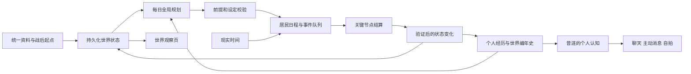

# 翁法罗斯完整性复审与二期方案

日期：2026-11-10。对象：当前工作区的翁法罗斯重构，以及聊天、主动聊天、世界书、旧世界存储、设置页和验证脚本的接入。

## 1. 复审结论

当前实现属于可运行的第一阶段：资料目录、固定作息、每日模型事件、公共事务摘要、持久化和独立页面已经接通。它还没有形成每个居民都能积累经历、改变选择，并共同改变环境的持续世界。

上一轮“完成重构”的表述偏满。114 项相关测试和共享核心检查证明了当时覆盖的工程行为，不能证明角色塑造、长期因果和世界生活的完整性。

本次重新阅读代码并运行 8 组隔离复现；只生成复审材料，没有修改业务代码，没有使用个人世界数据、真实供应商或外部渠道。以下区分已复现问题、代码可确认的能力缺口、建议的新设计。

## 2. 当前能力边界

| 能力 | 现有实现 | 距离目标的缺口 |
| --- | --- | --- |
| 后台独立运行 | 与主动聊天、页面开关分开；租约、退避、取消、重启去重 | 还缺长时间运行和真实供应商验证；崩溃恢复有状态边界问题 |
| 世界资料 | 19 个居民条目、10 个地点、5 个历史节点和来源链接 | 多数人物仅简短描述，NPC 共用性格说明；尚非完整剧情、任务、角色关系与说话方式资料库 |
| 现实时间 | IANA 时区、跨日、昼夜、餐食、睡眠 | 所有人使用同一作息表；尚无个人习惯、值勤轮换、地点营业、旅行耗时 |
| 居民自主性 | 静态职业、愿望、关系文字，以及即时活动 | 没有逐人持久化的需求、目标进度、记忆、约定、关系变化和已知消息 |
| 事件发展 | 每日一次生成完整事件，包括未来结果；到时应用 | 缺少前提、选择、阻碍、失败、取消、延期和现场结算 |
| 世界变化 | 结束时替换公共事务摘要 | 没有城邦、设施、通路、物资、组织等可被事件实际改变的状态 |
| 连续历史 | 最多 60 天日计划、80 条事务，模型参考最近 16 件完成事件 | 无长期编年史、重要事实索引；未结事务可能被裁掉 |
| 昔涟融入 | 公共事件参与次数受限；个人生活注入普通聊天 | 个人时间线仍主要只给昔涟建立；普通主动聊天存在漏接世界状态的路径 |
| 世界观察 | 事件、居民、地点、日记、资料标签页 | 看不到事件前因后果、人物经历变化、城市状态和“离开后发生了什么” |

代码依据：`src/shared/amphoreus-world.ts:59` 的持久化状态只有日计划、尝试、事务、应用过的事件 ID 和时钟；`src/main/amphoreus-world/engine.ts:79` 开始专门生成昔涟的个人投影；`src/shared/amphoreus-canon.ts:45` 的六位 NPC 共用性格与愿望模板。

“十二黄金裔席位”也不能直接作为居民个体模型。目前缇宝、缇安、缇宁合成一个 `tribios` 条目，无法分别活动、拥有不同经历。二期需要把席位、人物个体和关联身份分开建模。

## 3. 已复现的问题与现有取舍

复现脚本位于本地 `.build-temp/amphoreus-completeness-probe.ts`，执行：

```bash
node .build-temp/run-amphoreus-completeness-probe.mjs
```

报告：`.build-temp/amphoreus-completeness-probe.json`。这些是审查用构造输入，证明当前机制允许对应行为；没有声称真实模型已经生成过这些内容，也没有把模拟 30 天说成连续运行 30 天。

### F1 / P1：未结事务会因容量上限被删除

- 位置：`src/main/amphoreus-world/engine.ts:75`。
- 触发：已有 80 件 `open` 事务，再完成一个新增事务的事件。
- 实测：最早的 `old-0` 被移除，剩余仍为 80 件。
- 影响：没有解决的事情从世界和后续模型输入中消失。与稳定延续公共事务的目标冲突。
- 修复：容量限制用于读取窗口；未结事务保持持久化。已结事务归档并保留完成事实和事件引用。新增事务达到预算时合并或暂缓，不能直接裁掉未结事项。

### F2 / P1：设定约束只有提示词，矛盾剧情仍能进入历史和聊天

- 位置：`src/main/amphoreus-world/narrative.ts:32`、`src/main/amphoreus-world/engine.ts:138`。
- 触发：事件结构、人员和时间合法，但结果写入与当前规则冲突的火种转让和身份变更。
- 实测：构造的冲突结果通过解析，并进入完成事件的聊天上下文。
- 影响：静态人物卡保持正确，也无法阻止动态叙事覆盖其含义。
- 修复：把可变事实与不可变身份分开；模型返回引用事实 ID 的有限状态变更，校验后提交。涉及设定变更或重大事件时增加语义一致性审查；自由文本也需与已提交变化核对。结构校验通过只能代表格式有效。

### F3 / P2：普通主动聊天缺少统一的世界状态

- 位置：`src/main/proactive/proactive-lifecycle.ts:223`、`src/main/proactive/proactive-prompt.ts:146`。
- 触发：主动聊天候选没有 `moment` / `momentContext`。
- 实测：给提示构造函数提供世界状态标记，普通候选不包含该标记；补上心事候选才包含。
- 影响：睡眠、当前位置和近期经历不能约束所有主动消息，接入完整性不足。这里只证明上下文缺失，不推断实际模型一定会编造。
- 修复：所有陪伴输出都获取同一份世界认知快照；心事选择只决定分享什么，不决定有没有世界状态。

### F4 / P2：已生成计划在切时区后会覆盖餐食

- 位置：`src/main/amphoreus-world/engine.ts:32`、`src/main/amphoreus-world/service.ts:32`。
- 触发：已生成 UTC 09:00–09:45 的活动，然后把资料时区改为 Asia/Tokyo。
- 实测：当地 18:15 的昔涟仍执行公共工作，覆盖晚餐时段。已有当天成功计划不会重排。
- 修复：明确时区变更策略：已发生历史保留原时间，未开始计划按新时区修订；正在发生的事件明确结束或过渡。修订必须保留事件身份，重验餐食、睡眠、重叠和路程，并保持单日生成预算。

### F5 / P2：完成事件仍以计划摘要注入聊天

- 位置：`src/main/xilian-world/life-context.ts:83`。
- 触发：事件摘要是“准备校对物资”，完成结果为“校对物资已完成”。
- 实测：生活快照的“最近完成”仍为“准备校对物资”。
- 修复：完成事件优先使用结算结果，计划摘要只用于尚未完成的状态；公共听闻与本人亲历分别组织文本。

### F6 / P2：第三次尝试崩溃后可长期显示生成中

- 位置：`src/main/amphoreus-world/service.ts:35`。
- 触发：持久化记录为 `count=3,status=generating`，进程退出，租约已经过期后重启。
- 实测：达到次数上限的提前返回阻止状态收敛，仍显示 `generating`。
- 修复：先恢复过期租约为中断/失败状态，再判断是否还有尝试额度；界面展示当天已耗尽额度及下次可推进时间。

### F7 / P2：长期群像覆盖尚无保障

- 位置：`src/main/amphoreus-world/narrative.ts:56`、`:107`。
- 触发：连续提供 30 天、每天重复同样 7 位居民的合法计划。
- 实测：全部接受，另外 12 个条目从未参加公共事件。轮换关注名单只存在于输入，校验器没有跨日参与记录。
- 完善：保留每人的最近实质活动、未完成愿望和合理空闲时间。按目标紧迫度与被忽略时长选择焦点，接受私人生活进展，不强迫所有人轮番参加公共大会。长时间没有进展需要有明确理由或补充安排。

### F8 / P2：离线多日是日期跳跃，尚无世界过渡

- 位置：`src/main/amphoreus-world/service.ts:29`。
- 触发：11 月 10 日生成后暂停，到 11 月 14 日恢复。
- 实测：仅保存 10 日和 14 日日程；11–13 日没有变化、摘要或显式空白区间。
- 性质：这是一期已经写明的取舍，并非退避或去重失效；但无法满足“离开期间世界仍在发展”的体验。
- 完善：保存明确停机区间，恢复时先做确定性时间结算，再用有预算上限的补叙总结必要变化。补叙有独立来源标记；不能声称停机时实际运行过模型，也不能一次补发数十次请求。

## 4. 为什么会有框架感

### 4.1 居民还没有自己的“昨天”

人物卡包含愿望和关系文字，但运行状态没有对应的进展。模型每天重新阅读同一套人物简介，再写几件公共事件。其他居民没有像昔涟一样的个人经历投影，无法可靠回答“她为什么今天改了主意”“他昨天答应的事怎样了”。

作息使用同一份 `SLOTS`；昔涟心情只有睡眠/其他两种固定文案，精力基本为 85/70。对疲倦、疾病、兴趣、夜班、约定或长期投入都没有真实反馈。

### 4.2 事件结果提前写好，后续变化不能改变结局

每日计划必须同时给出 `summary/outcome/developments`。时间到后直接应用结果，没有验证当时的条件、人物状态或前序事件是否允许它发生。这能生成连续的日历，尚缺“行动—遇到变化—重新选择—产生后果”的过程。

### 4.3 城市只有介绍，尚无可以改变的环境

地点条目没有设施状态、开放时间、通路、供需或组织活动。修复桥梁、准备庆典、恢复商铺这些事情即使被写进文本，也不会改变后续的通行或生活规则。因此事件容易成为相互替换的短篇。

### 4.4 记忆容量与历史容量混在一起

模型短上下文需要限制，世界事实不应因此被删除。当前最近 16 件事件、60 天计划和 80 件事务的限制缺少独立的归档、检索及长期摘要。重要承诺和已经结束的故事需要可以持续追溯。

### 4.5 资料与认知尚未统一

世界计划使用 `amphoreus-canon.ts`，普通聊天继续加载 `prompts/worldbook/*`。两套资料没有统一事实 ID、适用时期和冲突裁决。旧世界书信息量较大，但没有完整纳入这次校订。

此外，所有近期公共事件都会作为背景交给昔涟，只有“未参与只能说听闻”的文字约束；没有表达她何时、从谁处得知了什么。世界观察页可以全知，角色说话应使用其个人认知。

## 5. 二期目标：让经历改变选择

### 5.1 资料基线与初始状态

- 为人物、身份、关系、地点、组织、任务和历史事件建立事实条目，包含来源、版本、适用时期及确定程度。官方历史、项目延续前提、运行中新增事实分别存储。
- 补齐人物的价值取向、表达习惯、偏好、重要关系、矛盾与未竟愿望；资料缺失时明确留空，不用模板充当已经核实的个性。
- 将黄金裔席位与人物个体拆开；三子拥有各自状态，共享席位关联。相关身份也通过关联关系建模，避免同时出现在相互冲突的活动中。
- 建立战后起点表：每人和每处地点的初始状态、约束、未解事项，以及哪些内容是本项目的延续假设。
- 日计划与聊天共用同一事实服务；保留用户自定义世界书，迁移时给出来源和冲突标记，不直接覆盖。

### 5.2 每位居民的持续状态

新增 `ResidentState`，至少保存当前位置及路程、体力与休息需求、当前关注、短期目标、长期愿望、约定、个人经历索引、认知消息和有证据的关系变化。

内部数值只用于调度。页面使用“昨晚休息不足，今天推迟出门”“仍在等那份回信”这样的解释。居民可以拒绝、改期、独处或过平淡的一天；不要求所有人都围绕用户或昔涟行动。

昔涟的生活、自拍、主动消息和普通聊天使用同一状态投影。世界内的人物关系独立于用户现实关系记忆。

### 5.3 可结算的事件和环境

事件拆成意图、安排、实际进行、结算和后续影响。记录参与者、前提、地点容量、开始窗口、持续时间、前序事件及允许修改的字段。事件可以完成、部分完成、失败、取消、延期。

日计划只承诺打算做什么。到关键节点时，用实际状态判断是否能开始，并按需要批量调用模型结算。返回的变更必须通过条件校验，再在一个事务内写入事件、居民、地点和后续任务；重复结算不重复生效。

环境先做必要的少量状态：设施与通路、营业安排、公共项目、粗粒度供需、地方事件。不必先做完整经济游戏，但“修好一条路”必须真的影响以后能否通行。

### 5.4 个人记忆、消息传播与长期编年史

- 亲历、转述和公共公告分别记录；信息传播有来源和时间。昔涟未得知的事情不会直接成为聊天事实。
- 重要事件、未解事项和承诺长期保留；已结事务归档，窗口限制只影响读取数量。
- 建立日摘要、阶段摘要和可检索的事实索引；摘要不能代替原始事件引用。
- 普通聊天、主动聊天、自拍共用 `WorldAwareness`，包含当前活动、本人最近经历、已知消息与尚未兑现计划。

### 5.5 可观察的世界页面

首页回答“现在是什么时候、各处怎样、最近为什么发生了这些事”。建议增加：

- 轻量城邦示意图，可查看当地居民、设施和事件。
- 居民详情：今日安排、近期经历、正在惦记的事、关系变化及其依据。
- 事件详情：起因、参与者、过程、结果、后续；可沿事件链回看。
- 世界编年史与“上次离开之后”，把关键变化汇总出来。
- 日常片段、书信或图片通过已发生事件产生；生成物可查看内容并追溯原事件。

继续保留按需加载、隐藏页面停轮询和手机适配。静态资料按版本缓存，动态数据分页并按修订号更新；利用已有连接通知变更。动画仅用于有限的昼夜和位置过渡，不增加大型 3D 场景作为前置条件。

## 6. 建议运行结构与成本控制



沿用一个全局规划服务，居民通过状态和调度表达自主性。模型调用建议为每日一次规划，加少量按需批量结算，并设置每日次数、token 和耗时预算；日常时间推进不调用模型。具体默认额度需要用真实供应商验证后确定。

模型不可用时，按已知条件执行可确定的生活行为；未知事件结果保持待结算、延期或中断。重要结果应有来源，不用模板伪造成功。

持久化建议逐步使用项目现有 SQLite 基础设施，分离事件日志与可重建的当前状态。保留旧 JSON 原件、现有事件 ID、日记和自拍关联，增加迁移版本与校验记录。运行进程维持单一写入者，模型返回时验证其引用的状态版本。

## 7. 开发顺序与验收标准

| 阶段 | 具体交付 | 必须通过的验收 |
| --- | --- | --- |
| A：连续性修正 | F1–F6；统一世界认知入口；补对应回归测试 | 未结事项不消失；已完成内容使用结果；时区变更不覆盖保护时段；所有主动场景拿到状态；过期租约收敛 |
| B：居民与环境 | 统一资料、初始状态、个体/席位拆分、逐人状态、差异作息、通路和场所 | 一人前一天的经历实际改变第二天选择；其他居民具有可追溯经历；路程可达且人员不重叠 |
| C：因果与长期推进 | 事件前提/结算、有限状态变更、消息传播、长期档案、离线过渡 | 前序事件失败会影响后续；被取消事件不产生成功影响；重复应用不改变结果；重启和 90 天压缩演练可持续追溯 |
| D：世界体验 | 城邦概览、居民经历、事件链、编年史、离开后汇总、生成物预览 | 用户能从页面或昔涟的解释中知道变化的原因和后果；移动端可用；首屏预算不退化 |
| E：部署与生成质量 | 隔离真实模型测试、Linux 服务验证、CF Tunnel 弱网验证 | 验证设定一致性、重复率、角色覆盖、成本、停机恢复与长时运行；分别记录构造测试和真实运行的证据 |

B、C 的完成标准比“多生成几条事件”更严格：选择几位居民和一个公共项目，运行一周压缩场景。每个人的选择应有自己的原因，项目的发展受真实前提影响，其结果应进入后续状态。展示文案必须能沿引用回到实际发生的事件。

## 8. 一段用于验收的项目续写示例

以下仅是二期机制的测试情境，不是官方剧情：

德墨忒尔发现次日到货受阻，先形成供应问题和可追踪的委托。达利安查明一段通路暂不可用，哈托努斯需要等工具才能修理。阿格莱雅协调替代供应，不同居民据自己的职责与空闲时间决定是否参与。修理没有成功时，通路仍不可用，第二天路线与供给安排必须调整；成功后，通行状态才改变。

昔涟当天可以一直忙于自己的写作。她稍后从居民处得知变化，才有资格向用户说“听说那边恢复了”；如果她参与过其中一段，个人日记记录实际参与的部分。第二天她的行动可以受到这条通路的状态影响，而不会因她没有参与就阻止整个故事发展。

这段情境同时检验独立居民、公共环境、前提与后果、消息传播、个人记忆和跨日连续性。通过这类行为验收后，才适合把本功能称为持续演化的世界。

## 后续实施

本文件保留复审时的发现。2026-11-11 已按[二期实施设计](2026-11-10-翁法罗斯二期实施设计.md)落实主要链路，修复与验证详情见[二期实现与验收](2026-11-11-翁法罗斯二期实现与验收.md)。
