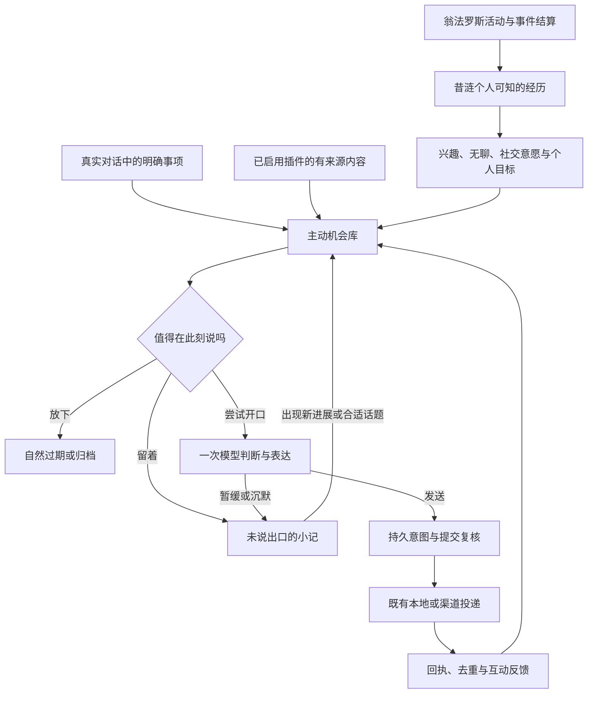

# 主动关心与翁法罗斯三期设计

日期：2026-11-17。状态：已按用户指示进入实施。方案中的动机、节奏、个人生活及群像后续已接入代码，具体验证与限制以[三期实施与验收](2026-11-17-主动关心与翁法罗斯三期实施与验收.md)为准；下文保留设计依据及验收契约。

用户希望主动消息可以密集，但应来自昔涟自己的无聊、见闻、兴趣和牵挂，同时继续完善翁法罗斯。用户已明确选择“兼顾世界发展和昔涟生活”：群像世界的持续发展与昔涟个人生活同步完善，生活中的具体变化自然带出主动消息。下文参数是首轮调试建议，不是已生效配置或每日发送承诺。

## 1. 体验目标

昔涟在自己的世界里生活，会遇到事、形成想法，也会选择找用户聊聊。用户能感到她有生活的连续性，而不是每次聊天后开始一个新的倒计时。

允许这些节奏同时存在：

- 刚聊完不久，她遇到新的有趣细节，又来补上一句。
- 一下午有好几件想分享的小事，消息明显比平时多。
- 她正在专心做事，几个小时没有主动消息。
- 她有点无聊，想找用户玩一会儿；也可能最后自己找了件事做。
- 用户暂时没回，她把后面的念头留在小记里，等下次聊起再说。

这里的“无聊”来自她当时的生活状态。例如整理工作变得重复、等待别人、刚结束一件事后空下来。不能只用“用户多久没说话”替代她自己的生活。

高密度体现为愿意经常分享和接话；每天的上限只负责控制打扰，不承担“今天还欠几条消息”的目标。

## 2. 现状与有依据的缺口

### 2.1 主动消息

| 当前机制 | 体验上的后果 | 三期调整 |
| --- | --- | --- |
| `proactive-policy.ts` 将普通会话结束后 30 分钟设为统一静默期；高频档全局间隔也是 30 分钟 | 多种不同动机容易集中在同一时间边界放行 | 分开处理交谈占用、短暂防连发和不同动机的时机；时间放行不产生动机 |
| `proactive-lifecycle.ts` 在白天缺少具体候选时加入 64 分的 `ambient_companion`，默认目标分为 60 | 即使没有新的生活内容，也持续存在可评估的候选 | 撤掉常驻兜底候选；有依据的自发念头仍可形成机会 |
| 每日一条 `daily:` 小记、每日最多一条 `idle:` 提问 | 生活变化被压成每天一条摘要，无聊也容易变成固定问候 | 以具体经历、情绪片段和未说出口的念头形成机会 |
| 评估按场景固定退避 30 分钟，排序后取第一名 | 同一类机会不断按时重试，候选多也不一定有多样性 | 按机会及其证据版本评估；没有实质变化时不重问模型 |
| `CompanionLifeStore` 有能量、好奇与无聊值，但按半小时整除计算后把推进时间重设为现在 | 分钟级刷新可能抹掉尚不足半小时的累计时间 | 改成保留余量的持续积分，并将身体状态归并到世界居民状态 |
| 主动总日上限和生活队列的 8 条/日等内部上限并存 | 调高用户上限可能仍被另一个隐含上限限制 | 统一预算入口，问题类内容保留独立限制 |

无聊值问题已经用当前源码在临时目录复现：从同一条用户消息开始，推进同样的一小时，每分钟或每五分钟刷新得到 `energy=82, curiosity=58, boredom=0`；一小时后只刷新一次得到 `79, 62, 10`。这说明当前结果依赖轮询频率，不只是参数不合适。该实验没有读取个人数据或连接渠道。

### 2.2 翁法罗斯

二期已经有 21 位居民、个人目标与关系、十处地点与通路、事件意图与到期结算、失败和延期、个人听闻、长期归档，以及桌面/Web 共用运行时。三期沿用这些能力，具体增量是：

1. 公共事件目前每天 3–8 件，昔涟最多参与一件；她自己的细碎生活主要还是作息和泛化日常记录。适合保护群像，但不足以支撑丰富的个人分享。
2. 日常目标有固定的每日进度增长。需要进一步让推进来自实际行动、阻碍和阶段结果。
3. 公共事务已有延续记录，但阶段、选择、代价和关系后续仍较粗。
4. 世界知识已有亲历/听闻区分；不过 `formatAmphoreusContext` 仍将其他焦点人物的动态 `attention` 放入聊天提示。应在结构上过滤未知动态，不能只靠提示词要求模型别用全知视角。
5. 世界结果尚缺少面向“想不想告诉用户”的专门桥接。当前自动生活候选主要来自每日快照。

相关基线见[二期实现与验收](2026-11-11-翁法罗斯二期实现与验收.md)。本设计没有进行新的官方剧情考据；示例属于项目延续世界线中的待生成情境。

## 3. 统一链路

世界推进独立于主动消息开关。关闭主动消息后，她仍能积累生活；重新开启时筛选新鲜、有价值的内容，不把停用期间的事情逐条补发。

## 4. 主动关心如何产生

### 4.1 五类动机

| 动机 | 生成依据 | 可以怎样开口 | 何时不适合 |
| --- | --- | --- | --- |
| 遇到有趣的事 | 已亲历的小事件、已听闻的消息、可信插件条目 | 分享一个具体动作、物件或小插曲 | 事件未发生、她尚不知情、内容与刚才重复 |
| 有点无聊，想找人 | 当前活动单调、等待、收尾后的空闲，加上社交意愿 | 提出一个轻松话题、小选择或一起玩的邀请 | 她正在睡觉/忙碌，用户已经连续未回复 |
| 想到用户 | 当下经历关联到用户明确说过的兴趣、共同话题 | “刚才碰到这个，想起你之前说的……” | 只有泛化的“好久没聊了”，或关联是凭空编的 |
| 牵挂某件事 | 用户明确提过且愿意被跟进的考试、项目、烦恼等 | 围绕那一件事问一句，允许用户不答 | 事项已经结束、对方不愿再谈、上次还在等回复 |
| 想分享自己的进展 | 自己的小目标出现阶段变化、失败、改主意 | 讲自己的选择和感受，也可以只发一句 | 只有进度数字变化，没有新的内容 |

具体的无聊感本身可以是一个内部事件，不要求每次都先有公共大事。但一次持续的无聊片段只形成一个机会，不能每分钟换 ID 重新抽签。

### 4.2 先决定自己想做什么

生活状态变化后，昔涟可以继续手头的事、休息、与世界居民交流、记一笔，或找用户说话。主动聊天只是其中一种行动。

状态尽量保持少而明确：

- 身体精力：以翁法罗斯 `cyrene` 居民状态为唯一权威来源。
- 刺激与兴趣需求：受活动重复度、新鲜见闻、项目进展影响。
- 社交意愿：受自己当下空闲、近期交流和情境影响；居民间相处也会改变它。
- 对用户的分享意愿：由共同兴趣、最近互动和这件事的相关性推导。

发送消息不会自动等同于“已经获得交流”。她可以因为把一件事说出来而放下念头；交流带来的反馈应在收到回复后记录。用户暂时未回复也不直接导致负面情绪或关系扣分。

## 5. 发消息的时机与密度

### 5.1 将时间门槛改成机会选择

保留现有的开关、安静时段、占用状态、锁屏规则、暂停、日上限，以及生成与提交时的两次复核。改变的是固定 30 分钟统一静默和“日上限越高，全局间隔固定越短”的耦合。

新机制分为三层：

1. **必要的防打扰限制**：正在对话生成、用户明确说忙、安静时段、超预算时不能主动开新话题。短暂防连发只作为上限控制。
2. **机会价值**：看新鲜度、具体性、用户相关性、昔涟自己的状态、重复程度和回复负担。
3. **自然起意**：在确有动机的有效时间内，让起意概率随状态变化；状态也可以回落、转向别的行动，机会可以过期。

推荐采用可持久化的累计强度机制：为每个有效机会抽取一次阈值 `T = -ln(U)`，累计 `H += λ(state) × eligibleElapsedHours`。越有分享欲，强度越高。只有 `H >= T` 且仍值得说时，才尝试模型判断。

关键约束：

- `λ` 来自动机与状态；没有动机时为零。
- 安静、忙碌、离线等被阻止的时间不积累发送强度；恢复后从当前时刻继续，不释放“欠下的消息”。
- 对活动、情绪和可用状态变化分段积分，保留小数/时间余量。不能每次轮询都截断分钟，也不能把整段时间当成最后一刻的状态。
- 阈值、累计值、证据版本和随机序列位置持久化。重启、刷新页面和切换轮询频率都不能重新抽签。
- 机会有有效期，欲望会衰减，也可能改做别的事；持续时间变长不应让每件琐事最终都必发。
- 从安静时段恢复时至多重新选择一个合适机会；过期内容直接丢弃或留作回顾。

这套概率机制只负责自然起意。它不承担剧情生成，也不保证任意给定分钟内一定发送。

### 5.2 首轮建议参数

| 项目 | 建议 | 作用 |
| --- | --- | --- |
| 密度档位 | 安静、自然、活跃；本需求建议活跃 | 调整起意强度和愿意采用的动机类型 |
| 每日主动开场上限 | 活跃档建议 20 次；实施迁移时尊重用户已有上限 | 上限不作为目标，不按剩余额度补发 |
| 短时防连发 | 独立主动开场之间至少 3 分钟，滚动一小时最多 4 次 | 允许局部密集，避免积压消息倾倒；时间到不产生候选 |
| 对话进行中 | 跟随用户正常接话，不额外插入后台主动开场 | 保持一个连贯话题 |
| 用户尚未回复 | 第一次后显著抑制；第二次仅允许新的、低负担独立内容；累计两次后暂停新开场 | 继续沿用两次未回复的硬保护，取消按时间催答 |
| 提问类内容 | 活跃档先保留每天最多 3 次的独立上限，可另设偏好 | 高频主要来自分享，避免每条都要求用户答题 |
| 晨间/晚间问候 | 作为偏好和情境，不再默认每天一早一晚必须出现 | 有新内容才尝试 |

“一次主动开场”对应一个业务意图。初期继续使用现有一次投递形式，避免靠拆气泡绕过限额；后续若支持分段，同一意图也必须受片段数与渠道投递数限制。用户回应后的正常聊天不算新的主动开场。

3 分钟和滚动小时限制也是待演练的参数，不能写进提示词变成“每过三分钟来一次”。明确预约的提醒继续走提醒机制，不能受随机起意影响。

### 5.3 生成结果不只有发和不发

一次模型调用同时判断并生成，避免先问“发不发”再调用一次写正文：

- `send`：有具体内容，现在适合说。
- `hold`：值得留着，等用户回到相关话题、自己空下来或事情有新进展。
- `drop`：重复、过时、不值得打扰，结束该机会。

`hold` 必须绑定可检查的恢复条件或到期时间。到期通常意味着结束，不意味着强制发送。模型选择暂缓后，原证据不变就不再每隔 30 分钟重复评估。

模型只接收这次动机需要的个人知识、关联的明确用户记忆、最近已分享内容和互动情况。不能要求模型“无论如何找个理由来一句”，也不能把仅有计划的事情写成刚刚发生。

自然表达中不需要每条都附“虚构角色小记”等固定前缀；世界线性质在上下文、界面和来源记录中明确。这里的“遇到”指翁法罗斯延续世界中的经历；现实新闻、图片、工具观察必须另有真实来源。

## 6. 翁法罗斯三期增量

### 6.1 昔涟的个人生活层

在公共事件之外增加个人行动与小事件，不占用群像的公共席位。保留现有昔涟每天最多参与一件公共事件的约束，避免所有居民都围着她转。

可以有一个持续几天的小项目、一次临时起意的散步、一件做得不太顺的小事、一个从别处听来的趣闻。这些活动应具有开始、进行、收尾或放弃状态，并与作息、精力、位置和当前约定相容。

每日规划可以顺带提出少量个人行动意图；本地规则选择可执行的活动。简单结果只在规则确实支持时结算，复杂经历并入现有到期结算批次。不能在早晨生成一篇完整日记后，到下午逐条把预写故事当事实发出。

个人生活的产物应能留下来：一张整理到一半的清单、一段读后感、一次练习的阶段结果。后续活动可以接着做，聊天和自拍也能引用同一份状态。

### 6.2 目标、关系与公共事务的后续

- 目标增加阶段、最近行动、阻碍与下一步。进度来自已完成行动及其效果，替换“到了晚饭就统一加进度”的主要推进方式。
- 阶段完成后可以结束、转入下一阶段或另选目标。失败和疲倦允许带来停顿、调整或求助，不要求每天向前。
- 公共事务在已有 `threads` 上补阶段、依赖事件与未解决问题。每次更新必须有事实依据，不能只是改写摘要。
- 关系变化继续引用具体事件，同时保留简短的相处变化：熟悉一种习惯、形成一个分歧、愿意再合作。无需每次都改变数值。
- 日常平静本身可以成立。避免靠不断出现危机来获得可分享内容。

### 6.3 个人认知成为统一接口

新增明确的个人知识投影，例如 `PersonalWorldView(residentId)`，供普通聊天、主动消息和自拍共同使用：

- 自己正在做的事、已知计划、亲历结果。
- 已听闻的公开结果，以及获知时间和来源。
- 自己可以知道的人物相处线索。
- 自己未说出口的小记和与用户聊过的部分。

世界观察页仍可展示全局信息；角色接口不接收其他居民未公开的即时关注、私人目标进展或未来结果。公开消息可以后续增加“谁在何地告诉谁”的传播记录，继续保留现有的公开传播延迟；无需第一阶段就模拟所有人逐句对话。

### 6.4 世界事件到分享机会的桥梁

世界事件进入已验证结果、昔涟首次获知、个人小项目出现实质变化时，记录一个语义变化。是否生成主动机会，再看她与此事的关系和新鲜度。

一次结果并不等于一条消息。同一事项可以只记日记、留着下次聊天，或者完全不提。已分享过的事情只有出现实质进展才能再次成为候选，不能换个措辞重新发。

用户在聊天里的建议可成为一个带来源的个人行动意图，仍需检查世界条件后才采用。用户说“把事情做成”不能直接写成公共事件已经成功。

### 6.5 观察入口

在已有翁法罗斯面板中补充“昔涟最近在忙什么”“还惦记的事”“自己的小项目”“最近讲给你听的片段”。展示有内容的变化，不把后台概率、欲望分数和冷却倒计时作为人物状态展示。

详细的候选淘汰原因、重试和费用保留在开发诊断入口，方便检查机械发送问题。继续沿用页面按需加载、增量刷新、隐藏时停止轮询和历史分页。

## 7. 数据、去重与恢复

### 7.1 最少需要保存的契约

`InitiativeOpportunity` 至少保存：

| 字段组 | 内容 |
| --- | --- |
| 身份与来源 | 机会 ID、动机类型、来源事件 ID/版本、个人获知记录 ID、来源类别 |
| 知识与表达 | 可用事实、想说的核心、关联话题、回复负担、已分享指纹 |
| 生命周期 | 待考虑、暂存、选中、已发送、放下、过期、投递待复核 |
| 时机 | 出现时间、有效期、恢复条件、累计强度、阈值、上次积分时刻 |
| 投递 | 会话范围、意图 ID、路由快照、回执关联 |

源事件可以面向不同获知者产生不同记录。对用户的分享去重采用“角色 + 来源事件 + 实质进展版本 + 会话范围”，同时做近期语义重复检查；不能只依赖每天变动的新 ID。

### 7.2 跨存储可靠性

世界快照仍先原子提交，再归档。将待传播的语义变化和世界结果写入同一快照，构成可重放的待处理记录；消费者先幂等建立机会，再确认已处理。崩溃发生在两步之间时可以重复读取，但不会重复建机会。

这不假设 JSON、SQLite 和外部渠道之间存在一个跨系统事务。发送继续使用现有持久业务意图、固定路由、epoch 与关系修订复核、渠道回执，以及 `partial/unknown` 停止自动重发的机制。

生成期间若用户发来消息，丢弃过时的开场表达；原有生活内容可以留待正常回复时使用。世界修订改变时，复核这次依赖的源事件与个人知识是否仍有效，无关居民的变化不应让所有生成一律失效。

### 7.3 迁移

- 计划将内层世界升为 schema 3，新增个人行动、阶段和待处理变化；具体兼容字段在实施时定稿。升级前备份 schema 2 原件，保留事件 ID、归档和作品关联；旧版程序应拒绝覆盖未来版本。
- 生活机会存储增加版本与上述来源字段；已投递及待复核的记录保留原意图，不重新生成或自动发送。
- 旧 `daily:` 和 `idle:` 队列项不直接批量升级为“现在想说”；可以保留小记，并仅对仍然新鲜的明确内容重新判断。
- 首次启用新桥接以当前已知记录建立游标，不把多年历史当新事件全部入队。
- 保留用户既有主动开关、日上限、暂停、安静时间、渠道和提醒设置。生活内部额度统一到主预算后，不擅自提高用户现有上限。
- 兼容需要旧生活能量字段的调用时，由权威世界状态投影；不能让两个存储各自继续计算身体精力。

## 8. 模型与运行成本

世界默认每天 8 次模型请求先沿用。公共结算及必要审核优先于新增趣闻和文风润色；为可能需要的审核预留预算，避免只生成结果却无额度审核。个人复杂结果尽量并入批次，普通作息和状态积分不调用模型。

主动表达使用独立的尝试预算并记录请求量、token 与成功发送量。被规则阻止的机会不请求模型；同一证据的沉默结果不反复收费重问。活跃档提高的是合适机会被采用的可能性，而不是每分钟请求模型。

每日模型预算不足时，她可以安静地继续已有活动，保存未结事项；不靠编造结果或临时套话填满主动消息额度。外部内容只使用用户已启用的数据源，不自动增加订阅或对外发布行为。

## 9. 分期实施与代码落点

| 阶段 | 交付行为 | 主要落点 |
| --- | --- | --- |
| P0：修正机械开场 | 修复刷新频率影响状态的问题；移除常驻白天兜底；统一预算；已有具体世界经历进入机会库；替换固定半小时开场门槛 | `src/main/proactive/companion-life.ts`、`proactive-policy.ts`、`proactive-trigger.ts`、`proactive-lifecycle.ts`；新增独立机会选择器 |
| P1：个人生活与念头 | 昔涟个人行动、小事件、持续项目、未说出口的小记；无聊时可选择其他行动；个人知识结构过滤 | `src/shared/amphoreus-world.ts`、`src/main/amphoreus-world/life.ts`、`engine.ts`、`prompts.ts`、`narrative.ts`、`state.ts`；新增个人知识投影和机会桥接 |
| P2：群像后续 | 目标阶段与行动证据、事务依赖、关系后续、有限传播链；完善长期历史读取 | `src/main/amphoreus-world/`、`src/main/xilian-world/world-store.ts` 及共享契约 |
| P3：观察与调优 | 个人生活展示、开发诊断、种子演练、真实内容质量复核 | `src/renderer/react/features/settings/AmphoreusWorldPanel.tsx` 及相关设置/国际化；扩展 `scripts/verify/amphoreus-world.mjs` |

`proactive-service.ts` 与 `proactive-prompt.ts` 承接新决策结果，但沿用既有持久意图和回执。`xilian-world/life-context.ts` 改用统一个人投影。所有阶段同时覆盖 Electron 与 headless 共享核心，不能只在桌面生命周期里接入。

先做 P0 与 P1：这两步最直接改变“像定时器”和“缺少自己的生活”的体验。P2 在连续性稳定后扩展，避免用更长的生成文本掩盖实际状态缺口。

## 10. 验收条件

### 10.1 可复现行为

1. **半小时边界**：低无聊、没有新事实和明确事项时，聊天结束后的第 29、30、31 分钟都不能只因时间到而产生常驻开场候选。
2. **轮询无关**：相同状态变化序列按每分钟、每五分钟、跨一小时推进，得到等价的精力/需求状态和累计强度；无损重启不改变阈值与选择。容差只允许数值精度和实际投递时刻的轮询延迟。
3. **无聊有生活依据**：等待、重复劳动可以提高无聊；阅读得投入、与居民相处、取得进展可以降低。用户不回复本身不能被记成情绪伤害。
4. **允许高密度**：连续提供不同、有价值的事件且用户积极互动时，活跃档允许短时间内多次分享，也允许一天超过现有生活队列的 8 次限制；不要求每天达到某个数量。
5. **允许安静**：专注/休息、内容重复或没有采用动机时，长时间没有消息成立，不出现“补足今天额度”。
6. **暂缓不是定时重试**：同一机会被暂存后，证据不变不再次请求模型；到期、休眠恢复和重启都不强制发送积压。
7. **知识边界**：私人事件、未知的他人动态关注、未结算结果不能进入昔涟的可用事实；听闻必须先有个人获知记录。
8. **进展与因果**：目标不因跨日自动完成；前序失败能改变后续；再次分享同一项目必须引用新进展。
9. **投递可靠性**：世界提交后崩溃、机会落库后未确认、生成时用户插话、渠道部分成功/未知结果、会话切换均不重复主动开场。
10. **配置与端一致**：旧档升级可恢复；未知版本不覆盖；桌面与 Web 同一时区/状态得到相同机会判断，浏览器打开/关闭不改变她的起意概率。

### 10.2 演练与内容检查

使用固定种子和隔离目录模拟“活跃对话日、普通工作日、三天未回复、连续离线再恢复”等情境。输出发送间隔、动机分布、重复源、问题占比、未回复后的行为和模型请求量，比较多个种子，检查是否仍在 30/60 分钟附近形成规律性开场。

统计图和发送数量只能辅助检查；还需逐条阅读样本，确认每次开口有自己的原因、表达不套话、故事前后一致。之后用独立数据目录和测试模型复核内容质量，先记录本地待发送草稿，避免为了测试向用户的真实渠道连发消息。

实施后的工程验证应包含主动模块与世界模块的聚焦测试、四端类型检查、共享核心构建，以及新增界面的桌面/手机检查。已有二期的 90 天演练也应扩展到个人项目、机会队列和归档恢复。通过构造测试不等于真实模型长期写作质量已经得到保证。

## 11. 期望看到的一天

以下只是验收时可以构造的例子，不是每天照着执行的时间表：

- 聊天刚结束不久，她手头的小项目出现一个新细节，发一句想分享的话。
- 随后专注做事，没有后台按半小时插进来问候。
- 等待一项安排时觉得有些无聊，想起你们聊过的小问题，来邀请用户一起选一选。
- 用户没有及时回应，她把后来听来的故事记下，没有继续问“在吗”。
- 晚上用户回来，她先接住用户的话；话题合适时再说白天留着的那件事。
- 世界里的其他居民仍有自己的事务与关系，昔涟的小项目也可能只推进一点，或者暂时改了主意。

成功的判断是：每次开口能说清楚她此时为什么想找用户，而实际阅读时又不需要看到调度器和概率公式。
