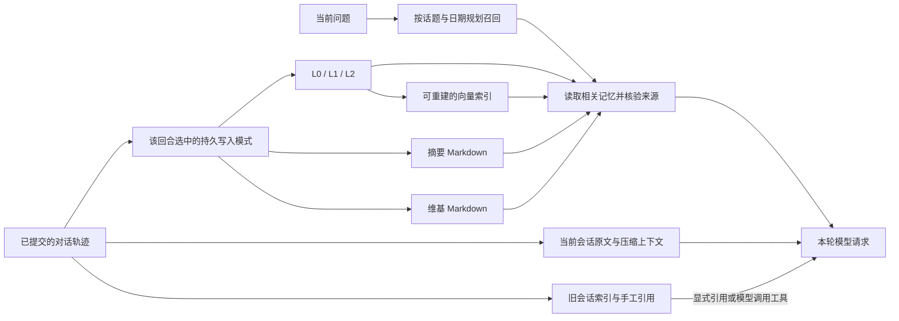

# 昔涟记忆体系核查与修复

核查基线为 `master` 上的 `v1.3.7-1` 与本轮工作树补丁。运行验证使用独立临时配置、SQLite 轨迹和受控模型响应。本文分别记录数据本体、可重建索引、模型实际收到的上下文，以及可以复现的缺口。

## 一轮对话怎样读写记忆

私聊的关系与社交状态、翁法罗斯生活、经审定的表达策略分别进入各自提示段。发送前的范围和来源检查决定这一轮实际可以使用哪些信息。

## 存储、写入和召回

| 层 | 权威数据和写入入口 | 实际读取与注入 |
| --- | --- | --- |
| 当前会话原始轨迹 | `cyrene.sqlite` 保存用户、助手、工具、编辑、分支、撤回及运行记录。历史 JSON/JSONL 先迁移为规范轨迹。 | UI 使用完整审计投影。模型用当前分支的可见轨迹或压缩前缀加原始尾部。旧会话工具另行按权威行和读取范围取证。参见 [数据库](../../src/main/storage/conversation-database.ts)、[模型与审计投影](../../src/main/orchestrator/conversation-transcript-projection.ts)。 |
| 单会话压缩 | Harness 根据模型窗口和系统、工具、消息总输入触发压缩。默认 256k 窗口时触发点 217,600 token，近期保留目标 40,960 token，实际边界保持问答和工具调用配对。使用原始轨迹序号与摘要提交 CAS，并保留完整审计数据。 | 重新构建同一个会话的后续模型上下文。失败时保留原轨迹，原文 UI 仍可访问。当前数据库构建热快照前仍读取完整审计序列，压缩节约模型输入，磁盘读取收益还有待实测。参见 [Harness](../../src/main/orchestrator/harness/cyrene-harness.ts)、[上下文压缩调度](../../src/main/orchestrator/build-options.ts)、[投影](../../src/main/orchestrator/conversation-transcript-projection.ts)。 |
| 旧会话工具与手工引用 | 历史可重建索引存 SQLite，索引候选最终逐条核对规范轨迹。手工引用只持久化会话标识与显示标题。 | `search_chat_history` 默认 5 项、最多 8 项，`read_chat_history` 默认 8 条、最多 12 条，单条 720 字符。搜索支持中英文、时间、分页和降级覆盖标记。手工引用取最多 16 条，以 10,000 字符为总预算，并在发送及本轮压缩后再次核对。参见 [工具](../../src/main/orchestrator/tools/chat-history-tools.ts)、[索引](../../src/main/storage/conversation-history-repository.ts)、[引用组装](../../src/main/chats/conversation-reference.ts)。 |
| L0 长期画像 | `memory.json`。向量模式后台提取需要合法字段、用户明确归因、有效原始来源，手工编辑可锁定并确认为本人维护。 | 进入本人会话的画像上下文。被手工管理的字段和来源仍有效的自动字段可读。来源失效的自动字段从注入中排除。参见 [记忆管理器](../../src/main/memory/memory-manager.ts)、[本人来源核验](../../src/main/memory/memory-owner-recall.ts)、[画像上下文](../../src/main/orchestrator/index.ts)。 |
| L1 近期状态 | 同一文件保存近期目标、偏好和当前项目。区分手工维护与有来源的自动更新。后台抽取以同一会话 6 轮有效对话为一批，使用前批最多 2 轮作重叠参照。待处理批次在 SQLite 恢复。 | 与 L0 共用来源核验，提供当前近况。切换模式时有效画像可延续。参见 [调度](../../src/main/memory/memory-scheduler.ts)、[待处理队列](../../src/main/storage/conversation-memory-repository.ts)、[本人来源核验](../../src/main/memory/memory-owner-recall.ts)。 |
| L2 事件、证据及冲突 | `memory.json` 保存事件正文、可选梗概、经核对的发生日期、证据及来源标识、固定与状态。支持批量抽取、显式保存、人工治理和现有条目的 Obsidian 正文回流。 | 普通文本先规划主题和日期，再查词法候选，符合条件时增加一次向量召回。重验来源、忘记表及日期，按主题择优，最多注入 4 条。低匹配时仅给梗概，强匹配给细节。已有的有效事件可经其他模式以文字读取。参见 [查询规划](../../src/main/memory/recall-query-plan.ts)、[事件召回](../../src/main/memory/memory-episode-recall.ts)、[呈现](../../src/main/memory/recall-presentation.ts)。 |
| 向量与活动度 | `rag-data/memory-store*.json` 的向量可由 L2 正文补建。L2 的 DMAE 活动度、召回统计、反思日志和实体图有各自的存储或投影。 | 语义检索限定在已对齐的 L2 中。无模型仍走文字召回。实时通话的工作记忆路径会更新 DMAE，普通文本使用查询计划，尚未接入同样的活动更新。反思日志和图谱主要用于查看和治理。参见 [向量存储](../../src/main/rag/vectorstore.ts)、[L2 活动度](../../src/main/memory/l2-dmae-manager.ts)、[记忆面板](../../src/main/memory/panel.ts)、[记忆图谱](../../src/main/memory/graph-view.ts)。 |
| 摘要模式 | `summary-memory/sessions/<会话哈希>.md` 保存单会话摘要。有工作区绑定的非普通 Chat 可写工作区内 `.cyrene/memory`。默认攒 10 轮或退出时刷新，同时记录来源。 | 摘要模式优先读当前会话及授权工作区。跨模式回忆要求可核验的来源，旧会话候选目前最多取最近 40 份、最后最多给 2 份。工作区与会话摘要上限分别为 1,200 / 800 字符。旧版本无来源 Markdown 只保留既有本域兼容处理。参见 [摘要调度](../../src/main/memory/summary-memory-scheduler.ts)、[摘要上下文](../../src/main/memory/summary-memory-context.ts)、[摘要文件](../../src/main/memory/summary-memory-store.ts)。 |
| 维基模式 | `memory/wiki` 中带来源的 Markdown 页面是内容本体，`wiki.sqlite` 是可重建索引。按 10 轮、等待 2 分钟、显式记忆或更正触发，启动时回补旧来源。 | 用结构化主题、谓词、值检索，按当前状态、来源和工作区可见性核验。可直接进入普通聊天提示词，也有维基搜索和阅读工具。删除和修订走来源核验、失效标记及索引同步。参见 [维基调度](../../src/main/memory/wiki-memory-scheduler.ts)、[维基存储](../../src/main/memory/wiki-store.ts)、[召回过滤](../../src/main/memory/wiki-memory-recall.ts)。 |
| 三种模式互读 | 模式只选择常规持久写入器。切换保留原有存储，与进行中任务用模式世代和持久进度协调。 | 同一回忆规划可并行读取其他模式留下的有效材料。支持分主题和核实发生日期，工作区及渠道权限保持独立。摘要模式、维基模式和向量模式的正文不会批量互相改写。关闭个人记忆后停止自动读写，手工旧会话引用仍由用户主动授权。参见 [模式](../../src/main/memory/memory-mode.ts)、[互读入口](../../src/main/memory/memory-compatibility-context.ts)、[模型接线](../../src/main/orchestrator/build-options.ts)。 |
| 私域社交记忆与关系 | 私聊社交事实保存于 `chat-social-atoms.json`，抽取任务有轨迹来源。独立关系日志保留回合与亲密度。owner 和不同渠道私聊 peer 分区。 | 提示词按范围注入可用社交事实、关系状态和场景，群聊或受限插件不共享本人记忆。渠道 peer 的工具另有隔离范围。当前情绪结合本轮文字判断。参见 [社交存储](../../src/main/social-context/store.ts)、[本人和社交来源核验](../../src/main/memory/memory-owner-recall.ts)、[范围策略](../../src/main/memory/memory-scope.ts)、[渠道范围](../../src/main/channels/memory-scope.ts)、[运行入口](../../src/main/orchestrator/agent-runtime.ts)。 |
| 主动关怀与待续话题 | `initiative-opportunities.json` 保存机会和待续想法，`companion-life.json` 保存陪伴生活安排。主动发送先提交权威会话轨迹，再走本地或渠道投递。 | 普通聊天主动问起和自动触发各有入口。对已经生成的记忆跟进，现在再次验证来源和遗忘状态，再决定能否显示或发送。参见 [主动生命周期](../../src/main/proactive/proactive-lifecycle.ts)、[主动服务](../../src/main/proactive/proactive-service.ts)、[普通聊天入口](../../src/main/orchestrator/agent-runtime.ts)。 |
| 昔涟生活与翁法罗斯 | `xilian-world.json`、`amphoreus-world.json` 和世界事件归档分别保存日程、世界进度及历史。 | 私聊按会话、世界规则和可分享状态得到当前生活、可讲事件及已发生故事。世界事件属于角色连续性，用户事实仍由个人记忆链负责。参见 [生活入口](../../src/main/xilian-world/life-context.ts)、[翁法罗斯运行时](../../src/main/amphoreus-world/runtime.ts)、[事件归档](../../src/main/amphoreus-world/archive.ts)。 |
| 知识库、世界书、表达学习、导出 | 文档知识库有独立资料和检索索引。世界书来自内置设定与可持久激活态。插件、B 站字幕和贴吧公开回复的表达证据走各自插件权限和审定。Obsidian 保存可读副本，绑定回流只更新已知 L2 ID。 | 文档和世界书作为各自的知识、设定输入。表达证据只生成可迁移的说话方式提示，B 站分享另可触发陪伴动态。导出和图谱服务于查看，仍需按个人记忆的范围和来源决定能否进入模型。参见 [知识库](../../src/main/knowledge-base/knowledge-base-service.ts)、[世界书](../../src/main/rag/worldbook.ts)、[插件提示词](../../src/plugins/prompts.ts)、[Obsidian 导出](../../src/main/memory/obsidian-exporter.ts)、[Obsidian 回流](../../src/main/memory/obsidian-importer.ts)。 |

## 本轮修复

1. Windows 安装包里的 ONNX 运行库存在，BGE-M3 权重未随包安装。增加「记忆 → 事件片段」的模型检测和用户主动下载或修复入口。安装后用本地推理检查索引，校验下载文件后原子发布。正文先落盘，向量文件写成功后才确认同步。重新链接已有的正确向量，兼容的向量予以保留，清理或重建时留备份。网络失败、正文写入成功和索引就绪分别显示。
2. 历史选择器可加载 30 项之后的会话，可按标题或完整 ID 找到旧会话，并可明确打开进行查看。手工选择时以原始轨迹核验可引用性。旧索引升级后收录已经发送的用户文字，即使没有成功的助手回复，也保留用户可见部分。草稿、活跃未完成项、失败回复、工具和内部正文仍受原有边界约束。Windows 额外修复了会话切换等待状态，子页面载入和同文档导航不会再阻塞切换。用实际桌面窗口验证「查看会话」点击后出现旧会话原文。
3. 手工引用在本轮触发压缩后按权威来源重验。来源仍有效才在当前请求恢复引用片段，原文不写入本会话的持久轨迹。
4. 普通聊天里曾缓存的主动跟进和主动发送前的最终检查共用来源验证，已撤回的旧事实不再从这两个入口出现。Obsidian 同一条记忆连续编辑时，用正文快照核对写入结果，避免迟到的旧向量盖过新版本。
5. L2 权重衰减只处理活跃和淡化中的条目。已经归档、由新事实替代或合并的记忆保持原状态，避免后台衰减重新激活旧事实。

本地嵌入模型的默认目录为数据目录下的 `models/Xenova/bge-m3`。完整模型包含 `config.json`、`tokenizer_config.json`、`tokenizer.json` 和 `onnx/model_quantized.onnx`。启动时还会检查自定义模型目录、其他既有安装路径和本地缓存。已经安装的模型可以直接走「修复向量索引」。修复读取已经保存的事件正文，正文版本发生变化时跳过过期的索引回写。

## 已复现的剩余断点与验收顺序

1. **先闭合跨源撤回。** 旧会话工具拒绝已经失效的派生回复后，当前会话的完整模型投影、将来的压缩输入和现存检查点仍可能复用旧派生正文。用真实 SQLite 权威行、生产投影和模拟已保存的检查点可复现。应给压缩记录保存可核验的跨源依赖，从仍在 SQLite 的审计轨迹重建受影响的前缀，并通过提交 CAS 处理撤回竞态。完整投影、增量压缩、重启后检查点三条入口都必须验证。旧记录缺乏来源指纹时需有独立降级策略。验收应同时证明同一检查点中的无关有效历史仍保留。参见 [压缩和模型投影](../../src/main/orchestrator/conversation-transcript-projection.ts)、[治理入口](../../src/main/memory/memory-governance.ts)。
2. **再校准召回与活动度。** L2 未带日期的普通语义检索使用最多 4 个语义候选，混合阈值 0.28。启用重排时分数口径变化，当前仍使用同一阈值。普通文字聊天与通话应共享「实际注入了哪些条目」的可观测记录，现有文字入口未更新全部 DMAE 活动和召回统计。修复或重启恢复的历史向量也不会补跑首次写入成功时的冲突探测。先固定中文多主题、弱匹配、相似事件冲突和无答案样本，对齐召回命中、来源有效率、误注入和延迟，再修改阈值或更新行为。参见 [事件召回](../../src/main/memory/memory-episode-recall.ts)、[混合检索](../../src/main/rag/retriever.ts)、[冲突写入](../../src/main/memory/memory-manager.ts)。
3. **复查旧会话与摘要的深度覆盖。** 旧会话工具当前仍以单日期区间组织一次调用。超长消息在正文较后位置命中时，读取从开头截取可能丢掉命中句，兼容摘要搜索也受最近 40 份限制。验收需要长文本命中位置、超过 40 份的有效旧摘要、独立多日期和范围隔离样本。工具与选择器面向普通本地 Chat。旧数据如果在初次迁移时因缺少历史模式而归为 Work，仍按 Work 范围管理。必要时应由用户直接判断分类，保留渠道、项目和任务的隔离。
4. **核对审计与实体治理。** 保留的原文、已发送消息、本地备份、外部导出与当前可召回内容有各自生命周期。用户在 Obsidian 或文件管理器中的副本由目标位置管理。需要验证再次导入是否遵从当前忘记规则，并把删除、撤回及是否留存明确反馈到各查看入口。关系日志、公开风格样本和世界记录有独立权限与生命周期。
5. **核对陪伴连续性的状态变化。** 删除曾关闭一个事项的源消息后，社交原子现在不会重开该待续事项。关系日志已落盘的每日小结与下次关怀线索未接入普通对话提示。世界观察页能按条件查历史，普通模型只看到有限近期记录。独立停用共享核心时使用的旧 Web 兼容入口也需单独核对渠道关系写入边界。参见 [社交存储](../../src/main/social-context/store.ts)、[旧 Web 模型服务](../../src/server/web-model-service.ts)、[世界归档](../../src/main/amphoreus-world/archive.ts)。

跨源撤回的复现顺序是先在会话 A 写入可检索的标记，再在会话 B 落盘一条记录了 A 来源指纹的助手回复，并准备一份含同标记的缓存检查点。撤回 A 的来源后，同一 SQLite 测试库中的历史工具不再提供 B 的派生回复。分别构建 B 的完整模型上下文、下一次压缩输入和现有检查点替换文本，三个入口仍可找到标记。测试没有调用外部模型。治理批次清理 L2、Wiki 或社交事实成功，应与这项压缩检查点验收分别报告。

## 可重复验证

- `node scripts/verify/chat-history-search-benchmark.mjs` 在 160 个会话、20,000 轮、120 条合成查询上测得热索引 Recall@5 为 100%、MRR 为 0.861、P95 为 27 ms。模拟失去全文索引时第一批有覆盖限制，60 条抽样的 Recall@5 为 40%、P95 为 546.3 ms。结果用于说明降级覆盖与冷启动差异，识别真实旧聊天中的改写、语义别名和复杂时间仍需另行评估。
- `corepack pnpm run build:server` 后运行 `node scripts/verify/shared-core-memory.mjs` 和 `node scripts/verify/shared-core-parity.mjs --history`。脚本使用受控模型响应、真实 HTTP/WebSocket 和真实 SQLite，验证来源、模式切换、失败、重启、读取与最终模型请求。
- 构建桌面与 Web 后运行 `node scripts/verify/companion-expressions.mjs --desktop --ui`。在带独立测试配置的 Windows Electron 中验证自动搜索与读取、选择器打开旧会话并显示原文，以及手工引用仅给本轮发送所选片段。
- Windows Electron 独立配置验证了缺模型时保存正文，添加合成 ONNX 后调用实际本地推理并产生 1,024 维向量，修复后重启可读取同一个向量 ID。下载器另有固定长度、SHA-256、失败清理和并发测试。本机直连官方权重地址超时，尚未实测完整 BGE-M3 权重下载或它对真实中文语料的相似度。
